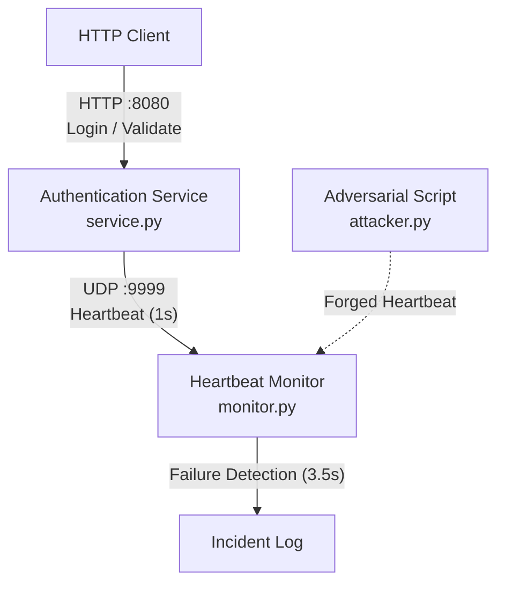

# CS 456: Authentication Service Failure Detection

## Overview

A lightweight authentication and ticket service demonstrating fault detection through an independent heartbeat monitor.

The service validates simulated credentials, issues session tickets, and experiences random process crashes. A separate monitor detects failures by observing missed heartbeats. An adversarial script tests whether forged heartbeat messages can conceal a service outage.

**Course:** CS 456, Modern Cybersecurity  

**Assignment:** Mini Group Project 1, Part 1: Failure Detection

**Team Members:** @ybenchouaf, @janerassadina, @nradaev, @mrob772

## Architecture



Three independent Python programs:

1. **`service.py` – Authentication Service:** A Flask HTTP API for login and ticket validation. Uses in-memory ticket storage, periodically emits UDP heartbeats, and randomly terminates its process.
2. **`monitor.py` – Heartbeat Monitor:** Receives heartbeat messages, maintains service health state, and logs failures when heartbeats stop arriving.
3. **`attacker.py` – Adversarial Assessment:** Sends forged heartbeat messages to evaluate whether the monitor can be deceived into reporting a failed service as healthy.

Communication:

`HTTP Client → Authentication Service (HTTP :8080)`

`Authentication Service → Heartbeat Monitor (UDP :9999)`

`Adversarial Script → Heartbeat Monitor (UDP :9999)`

All components operate on localhost.

## Authentication API

**POST `/login`**

Accepts JSON containing `username` and `password`. Valid credentials generate a random session ticket. Invalid credentials are rejected.

**POST `/validate`**

Accepts JSON containing a `ticket`. Returns whether the ticket is valid and unexpired.

For simplicity, authentication uses one hardcoded demonstration account. Tickets are randomly generated, stored in memory, and expire after 60 seconds.

## Heartbeat Protocol

- Pattern: Push-based UDP heartbeat
- Payload: `HEARTBEAT`
- Heartbeat interval (T): 1 second
- Missed-beat threshold (N): 3
- Timeout window (W): 3.5 seconds
- Monitor states: `WAITING`, `HEALTHY`, `FAILED`

The monitor starts in `WAITING` and becomes `HEALTHY` after receiving the first heartbeat. If more than 3.5 seconds pass without a valid heartbeat, it transitions to `FAILED`, prints a timestamped alert, and records an incident in `incidents.log`.

The monitor continues running after service failure. If heartbeat messages resume, it returns to `HEALTHY`.

The timeout allows three expected heartbeats to be missed, plus a small scheduling tolerance.

## Failure Injection

The service launches a background fault-injection thread that selects a random delay between 20 and 40 seconds.

When the delay expires, the entire service process terminates with a nonzero exit code.

The crash must terminate the process completely, including its heartbeat thread. The monitor must remain operational.

## Adversarial Assessment

The baseline heartbeat channel is deliberately unauthenticated.

The attacker sends forged `HEARTBEAT` messages to the monitor, attempting to maintain or restore a healthy status while the authentication service is offline.

The audit evaluates whether false heartbeats successfully conceal downtime and documents the underlying vulnerability.

### Reproducing the spoofing demonstration

Use three terminals in the project folder after installing the dependencies:

1. Run `python monitor.py` in the first terminal. It starts in `WAITING`.
2. Run `python service.py` in the second terminal. The monitor reports `HEALTHY`.
3. Wait for the service's random crash (20–40 seconds). Leave the service stopped.
   About 3.5 seconds after its last heartbeat, the monitor reports `FAILED`.
4. Run `python attacker.py` in the third terminal. Each second it sends the exact
   bytes `HEARTBEAT` to UDP `127.0.0.1:9999` and prints a timestamped send message.
   The monitor returns to `HEALTHY` even though the service is still stopped.
5. Leave the attacker running and restart `python service.py` in the second
   terminal. Wait for its next random crash. The monitor continues reporting
   `HEALTHY` because forged heartbeats keep arriving.
6. Stop the attacker with `Ctrl+C`, leaving the service stopped. The monitor
   reports `FAILED` about 3.5 seconds after the final forged heartbeat.

Show the exited service terminal alongside the monitor to distinguish actual
service availability from its reported status. Use `Get-Content incidents.log`
in PowerShell to show the recorded transitions. Stop the monitor with `Ctrl+C`
when finished. Both scenarios fit within a three-minute video.

### Observed outcome

The local process integration check ran the actual service, monitor, and attacker
as separate Python processes. After the first random service crash, the monitor
reported `FAILED`. Starting the attacker restored `HEALTHY`, which persisted for
at least five seconds with the service process exited. The service was restarted
while the attacker kept running; after its second random crash, the monitor
remained `HEALTHY` for at least another five seconds without logging a failure.
Stopping the attacker caused the monitor to report `FAILED` again.

The attack succeeds because the monitor accepts any datagram whose payload is
exactly `HEARTBEAT`. It does not authenticate the sender or independently check
the authentication API. The attacker's one-second interval keeps resetting the
3.5-second timeout. These are forged application messages from another local
process; the script does not spoof IP source addresses. A reported `HEALTHY`
state therefore proves only that matching UDP messages are arriving, not that
the authentication service is alive. Incident logging still records only state
transitions, so an outage concealed throughout by the attacker has no failure
entry.

## Installation and Execution

Requires Python 3.11 or newer.

1. Create and activate a virtual environment.

   macOS/Linux:
```bash
   python -m venv .venv
   source .venv/bin/activate
```

   Windows (PowerShell):
```powershell
   python -m venv .venv
   .venv\Scripts\Activate.ps1
```

2. Install dependencies with `python -m pip install -r requirements.txt`.
3. Terminal 1, start the monitor (it prints `WAITING`): `python monitor.py`
4. Terminal 2, start the authentication service (the monitor changes to `HEALTHY`): `python service.py`.
5. In Terminal 3, test `/login` and `/validate` while the service is running. The service crashes after 20-40 seconds, and tickets expire after 60 seconds. Replace `PASTE_TICKET_HERE` with the `ticket` value returned by `/login`.

   macOS/Linux:
```bash
   curl -s -X POST http://127.0.0.1:8080/login -H "Content-Type: application/json" -d '{"username":"demo","password":"password123"}'
   curl -s -X POST http://127.0.0.1:8080/validate -H "Content-Type: application/json" -d '{"ticket":"PASTE_TICKET_HERE"}'
```

   Windows:
```powershell
   $r = Invoke-RestMethod -Method Post -Uri http://127.0.0.1:8080/login -ContentType "application/json" -Body '{"username":"demo","password":"password123"}'
   $r
   Invoke-RestMethod -Method Post -Uri http://127.0.0.1:8080/validate -ContentType "application/json" -Body (@{ticket=$r.ticket} | ConvertTo-Json)
```

6. Wait for the random crash. Terminal 2 prints `[FAULT] Simulated service crash`, and within about 3.5 seconds the monitor prints a timestamped `FAILED` alert and keeps running.
7. In Terminal 3, run `python attacker.py` to test forged heartbeats. The monitor returns to `HEALTHY` even though the service is still stopped.
8. Stop the attacker with Ctrl+C. About 3.5 seconds later the monitor reports `FAILED` again.
9. Stop the monitor with Ctrl+C. Recorded transitions are in `incidents.log`.

## Testing

Use pytest for basic authentication and heartbeat-monitor tests.

Integration testing must verify:

- Successful login and ticket validation
- Rejection of invalid credentials and tickets
- Heartbeat transmission and reception
- Random termination of the service process
- Detection and logging of the failure
- Continued operation of the monitor
- Execution and observed outcome of the spoofing attack

## Scope and Limitations

This is an educational prototype, not a production authentication system.

Out of scope: persistent databases, real user accounts, production credential management, distributed deployment, automatic recovery/failover, and authenticated heartbeat channels.

These limitations are intentional. The project focuses on availability fault detection and adversarial analysis of the monitoring mechanism.

## Deliverables

- Working source code for the service, monitor, and adversarial script
- `CONTRIBUTIONS.md` identifying each team member's contributions
- PDF report documenting architecture, execution, timing decisions, and audit findings
- Narrated video demonstration under three minutes
- Individual reflections submitted separately through Canvas

See GitHub Issues for the implementation backlog.
