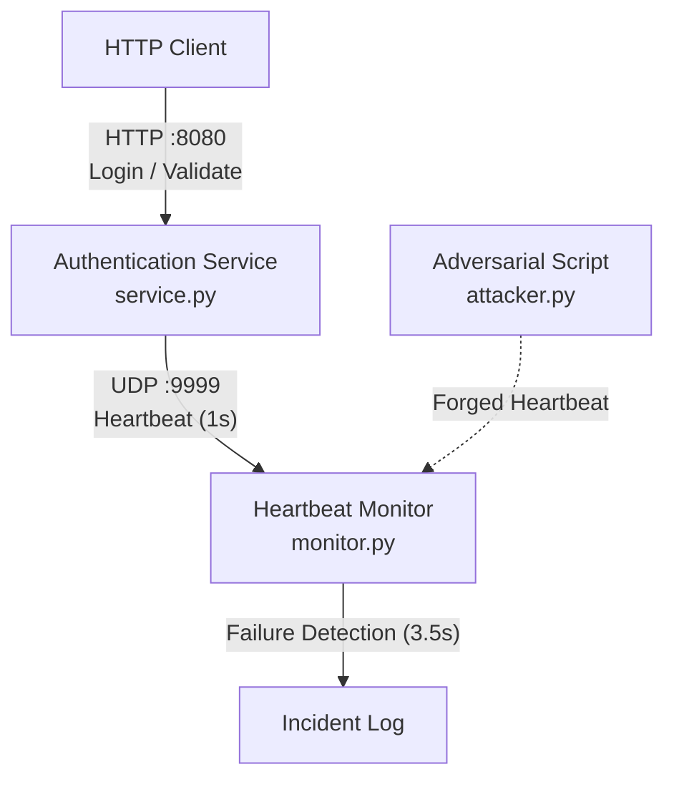

# CS 456: Authentication Service Failure Detection

## Overview

A lightweight authentication and ticket service demonstrating fault detection through an independent heartbeat monitor.

The service validates simulated credentials, issues session tickets, and experiences random process crashes. A separate monitor detects failures by observing missed heartbeats. An adversarial script tests whether forged heartbeat messages can conceal a service outage.

**Course:** CS 456, Modern Cybersecurity  

**Assignment:** Mini Group Project 1, Part 1: Failure Detection

**Team Members:** @ybenchouaf, @janerassadina, @nradaev, @mrob772

## Architecture

Three independent Python programs:

1. **`service.py` – Authentication Service:** A Flask HTTP API for login and ticket validation. Uses in-memory ticket storage, periodically emits UDP heartbeats, and randomly terminates its process.
2. **`monitor.py` – Heartbeat Monitor:** Receives heartbeat messages, maintains service health state, and logs failures when heartbeats stop arriving.
3. **`attacker.py` – Adversarial Assessment:** Sends forged heartbeat messages to evaluate whether the monitor can be deceived into reporting a failed service as healthy.

Communication:

`HTTP Client → Authentication Service (HTTP :8080)`

`Authentication Service → Heartbeat Monitor (UDP :9999)`

`Adversarial Script → Heartbeat Monitor (UDP :9999)`

All components operate on localhost.

## Authentication API

**POST `/login`**

Accepts JSON containing `username` and `password`. Valid credentials generate a random session ticket. Invalid credentials are rejected.

**POST `/validate`**

Accepts JSON containing a `ticket`. Returns whether the ticket is valid and unexpired.

For simplicity, authentication uses one hardcoded demonstration account. Tickets are randomly generated, stored in memory, and expire after 60 seconds.

## Heartbeat Protocol

- Pattern: Push-based UDP heartbeat
- Payload: `HEARTBEAT`
- Heartbeat interval (T): 1 second
- Missed-beat threshold (N): 3
- Timeout window (W): 3.5 seconds
- Monitor states: `WAITING`, `HEALTHY`, `FAILED`

The monitor starts in `WAITING` and becomes `HEALTHY` after receiving the first heartbeat. If more than 3.5 seconds pass without a valid heartbeat, it transitions to `FAILED`, prints a timestamped alert, and records an incident in `incidents.log`.

The monitor continues running after service failure. If heartbeat messages resume, it returns to `HEALTHY`.

The timeout allows three expected heartbeats to be missed, plus a small scheduling tolerance.

## Failure Injection

The service launches a background fault-injection thread that selects a random delay between 20 and 40 seconds.

When the delay expires, the entire service process terminates with a nonzero exit code.

The crash must terminate the process completely, including its heartbeat thread. The monitor must remain operational.

## Adversarial Assessment

The baseline heartbeat channel is deliberately unauthenticated.

The attacker sends forged `HEARTBEAT` messages to the monitor, attempting to maintain or restore a healthy status while the authentication service is offline.

The audit evaluates whether false heartbeats successfully conceal downtime and documents the underlying vulnerability.

## Installation and Execution

Requires Python 3.11 or newer.

1. Create and activate a virtual environment.
2. Install dependencies with `python -m pip install -r requirements.txt`.
3. Start the monitor with `python monitor.py`.
4. Start the authentication service with `python service.py`.
5. Use an HTTP client to test `/login` and `/validate`.
6. Observe the randomized service crash and monitor alert.
7. Run `python attacker.py` to test forged heartbeats.
8. Stop the attacker and verify that the monitor detects the missing heartbeats again.

## Testing

Use pytest for basic authentication and heartbeat-monitor tests.

Integration testing must verify:

- Successful login and ticket validation
- Rejection of invalid credentials and tickets
- Heartbeat transmission and reception
- Random termination of the service process
- Detection and logging of the failure
- Continued operation of the monitor
- Execution and observed outcome of the spoofing attack

## Scope and Limitations

This is an educational prototype, not a production authentication system.

Out of scope: persistent databases, real user accounts, production credential management, distributed deployment, automatic recovery/failover, and authenticated heartbeat channels.

These limitations are intentional. The project focuses on availability fault detection and adversarial analysis of the monitoring mechanism.

## Deliverables

- Working source code for the service, monitor, and adversarial script
- `CONTRIBUTIONS.md` identifying each team member's contributions
- PDF report documenting architecture, execution, timing decisions, and audit findings
- Narrated video demonstration under three minutes
- Individual reflections submitted separately through Canvas

See GitHub Issues for the implementation backlog.
