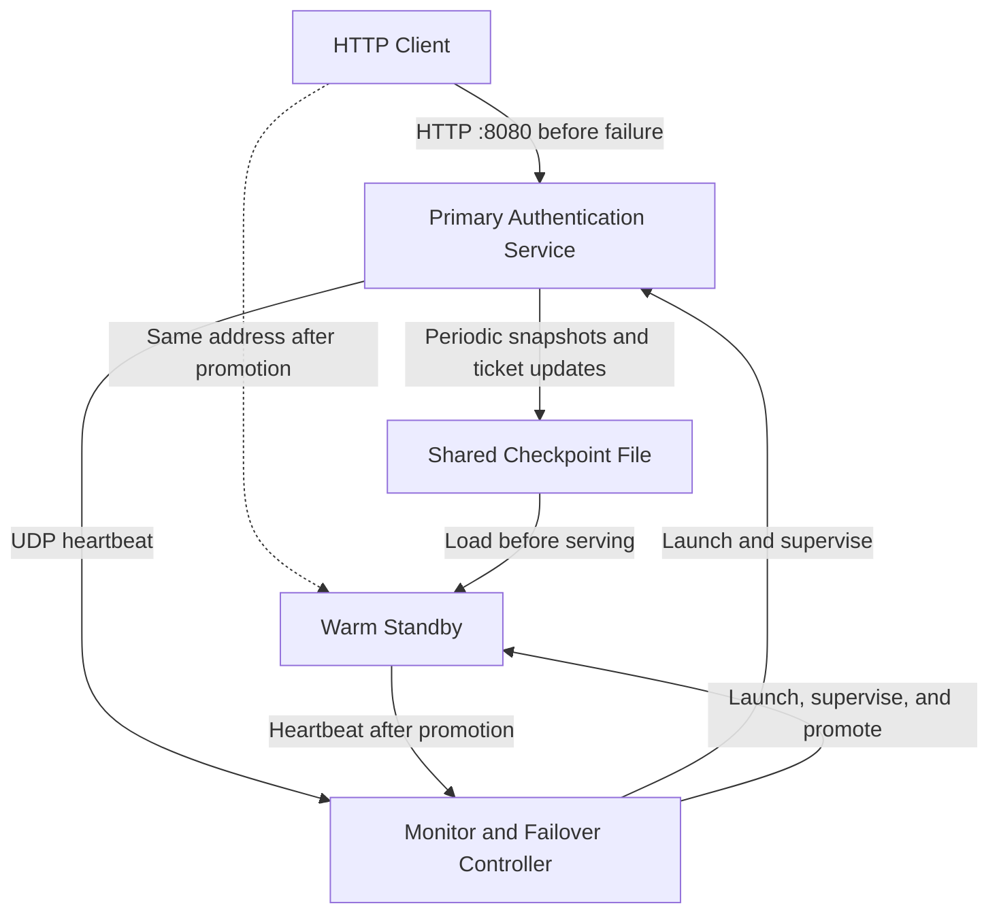

# Part 2 Architecture and Shared Interfaces

## Status

This document defines the implementation contracts established in Issue #19. Working components are delivered through Issues #20–#24.

Changes to shared interfaces should be agreed with the affected component owners and reflected in this document.

## Redundancy Model

Use passive redundancy with a warm standby.

The primary handles authentication requests. The standby runs as a waiting process until the controller promotes it. Session state is transferred through a local checkpoint file.

This approach reuses the Part 1 authentication API and heartbeat mechanism while keeping replication and client routing simple.

The trade-offs are checkpoint overhead and a nonzero recovery delay. Checkpointing before a successful login response preserves acknowledged ticket issuance across the simulated primary process crash.

## Architecture



Only one service process serves the client address at a time.

## Shared Configuration

`part2/config.py` supplies these defaults:

| Setting | Default |
|---|---|
| Host | `127.0.0.1` |
| HTTP port | `8080` |
| Heartbeat UDP port | `9999` |
| Heartbeat payload | Exact bytes `HEARTBEAT` |
| Heartbeat interval | 1 second |
| Heartbeat timeout | 3.5 seconds |
| Controller polling interval | 0.25 seconds |
| Checkpoint interval | 1 second |
| Ticket lifetime | 60 seconds |
| Primary random crash delay | 20–40 seconds |
| Startup timeout | 10 seconds |
| Restoration readiness timeout | 10 seconds |
| Checkpoint path | `runtime/part2/checkpoint.json` |
| Incident log | `runtime/part2/incidents.log` |

Runtime paths are resolved from the repository location.

Use monotonic time for elapsed-time measurements and timeout decisions. Use Unix timestamps for persisted ticket expiration deadlines.

## Process Interfaces

The planned controller entry point is:

```bash
python -m part2.monitor
```

The controller launches the service modes using the current Python interpreter:

```bash
python -m part2.service --mode primary --node-id primary
python -m part2.service --mode standby --node-id secondary
```

Both modes use the shared configuration defaults.

The service and controller will support these optional overrides for testing:

- `--service-port PORT`
- `--heartbeat-port PORT`
- `--checkpoint PATH`

The controller passes those values consistently to its managed processes.

For the heartbeat-loss audit, the service supports:

```bash
--suppress-heartbeats-after SECONDS
```

The controller forwards this option to the primary only. It suppresses heartbeat transmission after the specified interval while leaving HTTP request processing and the process running.

Importing a module must not launch servers, background threads, or child processes.

## Promotion Interface

The controller starts the standby with an open stdin pipe.

Promotion consists of writing the following line and flushing the pipe:

```text
PROMOTE
```

The corresponding shared constant is `"PROMOTE\n"`.

The standby must not promote itself because stdin closes or because it receives unrelated input.

Before promotion, the standby:

- Does not bind the HTTP service port.
- Does not send heartbeats.
- Does not write checkpoints.

On promotion, it loads and validates the checkpoint before starting the active service.

## Authentication and Readiness API

Retain the Part 1 demonstration credentials:

- Username: `demo`
- Password: `password123`

### POST /login

Valid credentials return a random ticket and `expires_in: 60`.

Invalid credentials return HTTP 401.

A successful response is returned only after the new ticket has been checkpointed. If persistence fails, return HTTP 503 and roll back the uncommitted ticket.

### POST /validate

Accepts a ticket and returns:

```json
{"valid": true}
```

or:

```json
{"valid": false}
```

An unknown or expired ticket is invalid.

### GET /health

A ready service returns HTTP 200 with:

```json
{
  "status": "ready",
  "node_id": "secondary",
  "pid": 12345
}
```

The node identity and PID must match the serving process.

The controller logs successful restoration only after this endpoint identifies its expected secondary process.

## Checkpoint Interface

`part2/checkpoint.py` exposes:

```python
save_checkpoint(path, tickets)
load_checkpoint(path)
CheckpointError
```

`load_checkpoint` returns the restored mapping of tickets to expiration deadlines.

Illustrative checkpoint format:

```json
{
  "version": 1,
  "saved_at": 1800000000.0,
  "tickets": {
    "example-ticket": 1800000060.0
  }
}
```

Requirements:

- Validate the supported version, required fields, and expected value types.
- Timestamp values must be finite numeric values.
- Discard expired tickets during loading.
- Preserve original expiration deadlines.
- Write a temporary file in the checkpoint directory and atomically replace the destination.
- Raise `CheckpointError` for missing, unreadable, or invalid recovery checkpoints.

The active service serializes state mutations and checkpoint writes with one lock so an older snapshot cannot overwrite newer state.

A fresh primary initializes a valid checkpoint before accepting authentication requests. Standby startup must not overwrite that checkpoint.

After promotion, the secondary becomes the checkpoint writer.

## Failover Sequence

1. The controller starts the primary and waiting standby.
2. The primary serves requests, saves checkpoints, and sends heartbeats.
3. The primary crashes after a random 20–40 second delay.
4. The controller reaches the heartbeat timeout and checks its primary process handle.
5. If the primary has exited, the controller logs `[Crash Detected]`.
6. It logs `[Failover Triggered]` and sends the promotion command once.
7. The standby loads the checkpoint and starts serving.
8. The controller verifies secondary readiness and logs `[Service Restored]`.

Recovery events are timestamped and written to the incident log.

Startup and readiness checks have bounded waits. Failed recovery produces an explicit error rather than a restoration message.

Stopping the controller cleans up its managed child processes.

## Heartbeat Disruption and Audit Behavior

If heartbeats stop while the primary process is still alive:

- Log the disruption.
- Keep the standby inactive.
- Continue checking process state.
- If the primary later exits, complete the recovery sequence after the timeout condition is satisfied.

This local process-exit policy avoids promotion based solely on missing heartbeats. It does not recover an alive but hung primary.

The corrupted-checkpoint audit must arrange for corruption to remain present until the standby attempts to load it. A subsequent primary snapshot must not silently replace the audit payload before that attempt.

Malformed checkpoint recovery must fail explicitly. Structural validation does not authenticate valid-looking malicious modifications.

## Validation and Reporting

Verify that a ticket issued before the primary crash remains valid after recovery through the same client address, provided its original expiration has not passed.

Measure and distinguish:

- Failure-detection delay.
- Promotion-to-readiness time.
- Overall client-visible recovery time.

Report actual observations, measurement methods, and audit limitations.
